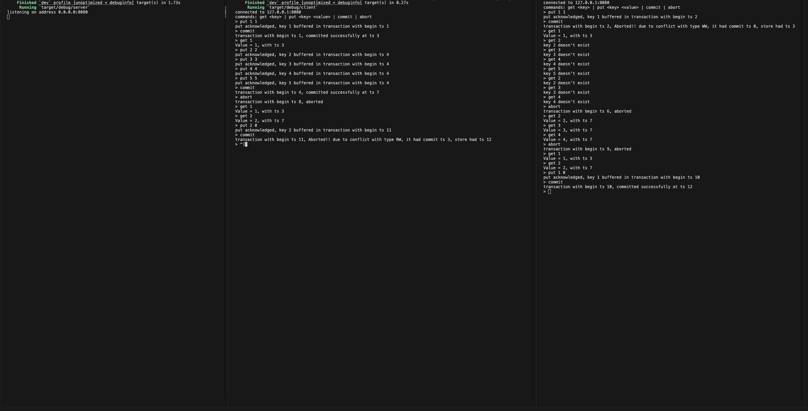

# Timestamped KV Storage Engine

An in-memory Rust key-value store for exploring transactional concurrency.

## MVCC + OCC

- Each transaction reads a timestamped MVCC snapshot and keeps its read/write sets.
- Writes are buffered; transactions read their own writes.
- Commit serializes validation, assigns one commit timestamp, then atomically publishes a copy-on-write store.
- OCC rejects stale write/write and read/write dependencies, preventing write skew and competing writes to a previously absent key.
- Old versions remain available to earlier snapshots. There are no range or predicate queries.

## Architecture


## Transaction demos

The test suite demonstrates snapshot reads, conflicts, write skew, phantom writes, atomic commits, and concurrent transactions.



```sh
cargo test
```

## TODO
```
Not fully serializable: reads of absent keys are never recorded. So "if neither X nor Y exists, create one" lets both transactions read the missing keys and insert different keys. The write-set check only compares each key against itself, so both commit. That is write skew through phantoms.
needs to records missing reads not just discard them
```
